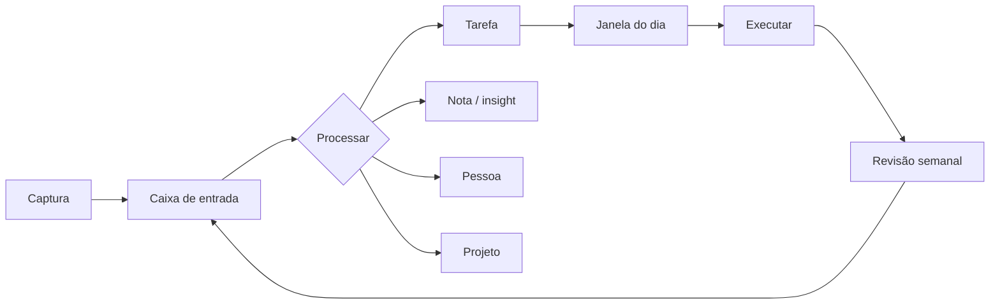

<div align="center">


# Zyra

**Sistema pessoal para capturar tudo o que chega, dar destino e colocar em prática.**

Ideias, insights, pessoas, projetos, tarefas e informações — organizados no ritmo das janelas do dia.

> Primeiro você. Depois o que você serve.

<br />

[](https://evelynjanynedev-hue.github.io/zyra-app/)
[](https://github.com/evelynjanynedev-hue/ideias)

<br />


</div>

---

## 🔗 Acessar o app

**Link fixo:** <https://evelynjanynedev-hue.github.io/zyra-app/>

Esse endereço é permanente: ele descobre qual instância do app está no ar naquele momento e
redireciona para ela. Pode salvar nos favoritos, mandar para o celular e adicionar à tela de
início.

> O app é **pessoal e protegido por senha** (HTTP Basic Auth). O navegador vai pedir usuário e
> senha antes de abrir qualquer tela — as credenciais são privadas, definidas em `ZYRA_PASSWORD`.

**Status da instância:** `GET /api/health` responde algo como
`{"ok":true,"banco":"remoto (libSQL)","tarefas":1}`.

> Como o app roda em uma máquina própria com túnel, o link só abre enquanto essa instância estiver
> ligada. Se a página disser “reconectando”, aguarde alguns segundos e tente de novo. Para rodar na
> sua máquina, veja [Como rodar localmente](#-como-rodar-localmente).

---

## 🎯 Para que serve

Zyra não é mais um lugar para guardar informação. É um sistema para **fechar o ciclo**:

```
capturar → processar → priorizar → agendar na janela → executar → revisar
```

A maioria dos apps de produtividade para na captura: você anota, arquiva e nunca mais olha. Aqui
cada item que entra na caixa de entrada **precisa de um destino** — e cada destino tem um próximo
passo.

- **Nada fica solto na cabeça.** Tudo entra na Caixa de entrada e é processado em tarefa, nota,
  pessoa ou projeto.
- **Presença antes de produção.** Todo dia a tela **Hoje** abre com uma afirmação, uma pergunta e
  práticas de ancoragem — incluindo **gratidão** e **perdão**. Ler “esteja presente, ancore” é
  ritual, não enfeite.
- **Pouca coisa importa por dia.** No máximo 3 prioridades, com uma estrela de foco — e
  **importância explícita** (alta, média ou leve) em cada tarefa.
- **Tempo não é uma coisa só.** Cada decisão separa **analisar, organizar, criar, executar e
  registrar**, com minutos estimados e um orçamento de tempo do dia.
- **O foco tem relógio.** Um pomodoro por fase conta o tempo de análise, execução ou registro,
  continua ao trocar de tela, sugere uma pausa de 5 min, guarda o histórico e avisa quando termina.
- **O dia tem ritmo.** As 12 janelas do relógio dos órgãos viram faixas de 2h com uma intenção
  clara.
- **O ciclo fecha.** Uma revisão semanal mostra o que ficou para trás — sem culpa, com decisão.



---

## 🚀 Como usar (primeiros 10 minutos)

### 1. Entre e olhe a tela **Hoje**

A tela inicial mostra a janela atual (com a intenção daquela faixa de 2h), quanto tempo falta para
ela acabar, as **3 prioridades** do dia e os alertas do que pede atenção. É o seu painel de
partida — não precisa configurar nada.

Antes de qualquer tarefa, o bloco **Presença do dia** traz a afirmação da data, uma pergunta de
ancoragem e o atalho para as seis práticas. Ele é determinístico: a mesma data sempre traz a mesma
frase, para virar ritual em vez de novidade.

### 2. Capture tudo na **Caixa de entrada**

Tem um campo de captura rápida no topo. Escreva a ideia, o lembrete, o nome de alguém, o link —
**sem julgar e sem organizar na hora**. Captura é despejo, não decisão.

### 3. Processe cada item (a parte que fecha o ciclo)

Na **Caixa de entrada**, cada item espera um destino:

| Ação | Vira | Quando usar |
|---|---|---|
| **Tarefa** | algo para fazer, com área, projeto, prioridade e janela | “preciso fazer isso” |
| **Nota** | insight, referência ou registro | “preciso lembrar disso” |
| **Pessoa** | contato com contexto e próximo passo | “preciso falar com alguém” |
| **Projeto** | resultado esperado com próxima ação | “isso é maior que uma tarefa” |
| **Arquivar / excluir** | sai do caminho | “não preciso mais disso” |

Regra de ouro: **se não tem próximo passo, não é tarefa.** É nota, é referência, ou não é nada.

### 4. Escolha as **3 prioridades** do dia

Em **Tarefas**, marque no máximo três como prioridade e **uma** como foco (a estrela). O resto
continua na lista — mas não compete com o que você escolheu para hoje.

### 5. Execute na **janela** certa

Em **Janelas do dia** você vê as 12 faixas, o órgão e o modo de cada uma, e marca o ritual do dia.
As tarefas aparecem agrupadas por atraso, hoje e semana — conclua ou adie em 1 clique.

### 6. Feche a semana na **Revisão**

A revisão mostra o que ficou: itens na inbox, tarefas atrasadas, projetos parados, pessoas sem
contato, rituais não feitos. Você decide o destino de cada coisa e registra como foi a semana.
**Nada é apagado sem decisão sua.**

### Atalhos de uso diário

| Quero… | Vá em |
|---|---|
| despejar uma ideia agora | **Hoje** → captura rápida |
| começar o dia presente | **Hoje** → presença do dia, ou **Presença** para as seis práticas |
| dar tempo a uma decisão | **Presença** → cinco fases e orçamento de decisão |
| ver o que tenho para fazer | **Tarefas** (filtre por área ou projeto) |
| planejar a semana | **Sprints** → criar sprint → puxar do backlog |
| guardar um aprendizado | **Notas** (com tags, área e vínculos) |
| não deixar uma relação esfriar | **Pessoas** → registrar contato e próximo passo |
| acompanhar um resultado maior | **Projetos** → próxima ação e progresso |
| fechar o dia/semana | **Revisão** |

### Instalar no celular (PWA)

Abra o link no navegador do celular → **Compartilhar → Adicionar à Tela de Início**. O app abre em
tela cheia, como um app nativo.

---

## ✨ Funcionalidades

| Tela | O que faz |
|---|---|
| **Hoje** | Janela atual com intenção, tempo restante, afirmação de presença, as 3 prioridades, orçamento de tempo por fase, captura rápida e alertas do que pede atenção. |
| **Presença** | Afirmação diária, seis práticas de ancoragem (presença, respiração, corpo, gratidão, perdão, intenção), relógio pomodoro por fase, guia das cinco fases e quanto tempo vale cada decisão. |
| **Caixa de entrada** | Captura sem julgar. Cada item vira tarefa, nota, pessoa, projeto — ou é arquivado/excluído. |
| **Tarefas** | Lista única com filtros por área e projeto, grupos por atraso/hoje/semana, foco, importância explícita, tempo por fase, atalho para o relógio de foco, conclusão, resultado registrado e adiamento em 1 clique. |
| **Sprints** | Scrum enxuto: objetivo do sprint, product backlog, story points, board a fazer/feito, encerramento com retrospectiva. |
| **Notas** | Insights, notas e referências com tags, área e vínculo com pessoas e projetos. |
| **Pessoas** | Rede com contexto, último contato, próximo passo e data — para não deixar relações esfriarem. |
| **Projetos** | Resultado esperado, status, próxima ação e progresso a partir das tarefas vinculadas. |
| **Janelas** | As 12 faixas do dia, o órgão e o modo de cada uma, com ritual diário marcável. |
| **Revisão** | Fechamento semanal: inbox, atrasadas, projetos parados, pessoas sem contato, rituais, âncoras, gratidão, perdão, resultados registrados e registro da semana. |

Outros detalhes:

- **Dados locais** em um único arquivo SQLite (`data/zyra.db`), sem conta, sem nuvem, sem
  telemetria.
- **PWA instalável** no celular.
- **Backup** em um comando (`npm run backup`).
- **Dados de exemplo** na primeira execução, removíveis em um botão na tela de Revisão.

---

## 🎨 Experiência visual: bater o olho e se localizar

O app inteiro usa uma **cor por domínio da vida** — não é decoração, é linguagem. Em qualquer tela
você reconhece de onde vem o item e o que ele pede:

| Cor | Domínio | Onde aparece |
|---|---|---|
| 🟡 **Âmbar** | foco / prioridade | estrela de foco, prioridades do dia, janela de foco |
| 🔴 **Vermelho** | urgente / atrasado | tarefas vencidas, prazos estourados, pendências |
| 🟢 **Verde** | feito / concluído | tarefas concluídas, rituais, projetos ativos |
| 🟠 **Coral** | caixa de entrada | captura, itens sem destino, processamento |
| 🟢 **Verde-água** | pessoas | contatos, relações esfriando, retomadas |
| 🔵 **Azul** | projetos | próxima ação, progresso, status |
| 🟣 **Violeta** | notas / insights | notas, referências, tags |
| 🔵 **Índigo** | sprints | backlog, board, pontos, retrospectiva |
| 🌹 **Rosa** | revisão | ciclo semanal, pendências, fechamento |
| 🟤 **Cobre** | janelas do dia | janela atual, rituais, ritmo |
| 🟣 **Lilás** | presença / ancoragem | afirmação do dia, práticas, perdão |
| 🌿 **Verde-sálvia** | presença concluída | práticas feitas, âncoras do dia |
| 🔵 **Azul** | fase analisar | tempo de entender o problema |
| 🟣 **Violeta** | fase organizar | tempo de escolher o menor caminho |
| 🟡 **Ouro** | fase criar | tempo da primeira versão |
| 🟠 **Âmbar** | fase executar | tempo de fazer a coisa |
| 🟢 **Verde** | fase registrar | tempo de anotar o resultado |

### Um painel global em todas as páginas

- **Barra de status no topo** (desktop e mobile): janela atual, inbox, atrasadas, foco, âncoras do
  dia, tarefas de hoje e o contador de **feitas hoje**. Se algo está pegando fogo, você vê antes de
  rolar a página.
- **Menu lateral colorido e agrupado** em *Fluxo* (Hoje, Inbox, Tarefas), *Contexto* (Sprints,
  Projetos, Pessoas, Notas) e *Ritmo* (Janelas, Presença, Revisão), cada item com **contador ao
  vivo** e ponto vermelho quando há urgência.
- **No celular**, barra inferior com as 4 telas principais e um menu **Mais** com todo o resto —
  incluindo os mesmos contadores.
- **O que já foi feito não some**: a tela **Hoje** tem a seção *Concluídas hoje* e a **Revisão**
  mostra *O que já foi feito esta semana*. Progresso visível sustenta o hábito.
- **Anéis de progresso** (SVG) para janela atual, sprint, projetos e ciclo de revisão — leitura
  instantânea de “quanto falta”.
- **Hierarquia por peso visual**: barra lateral colorida nas tarefas (urgente > foco > prioridade),
  cartões com borda de domínio, cabeçalhos com gradiente suave e microanimações de entrada
  (respeitando `prefers-reduced-motion`).

---

## 🧱 Stack (e por que ela)

| Camada | Escolha | Motivo |
|---|---|---|
| App | **Next.js 16** (App Router, React 19, Server Components + Server Actions) | Uma base só para tela e servidor, sem API separada. Rápido de evoluir. |
| Linguagem | **TypeScript** | Segurança para crescer sem quebrar o que já funciona. |
| Estilo | **Tailwind CSS 4** | Design consistente sem arquivos CSS espalhados. |
| Dados | **libSQL / SQLite** (`@libsql/client`) | Zero instalação e zero conta no dev (arquivo `data/zyra.db`); em produção, o mesmo SQL roda no **Turso** com link fixo. |
| Offline/local | **PWA** (manifest + ícone) | Dá para instalar na tela inicial do celular. |

**Por que não começar com Supabase, Firebase ou um backend na nuvem?**
Porque o problema hoje é **organizar a própria vida**, não escalar para milhares de usuários.
SQLite local é mais rápido, privado e barato. A migração para nuvem é possível depois, sem refazer
a interface.

**Por que não React Native/Expo?**
O custo de manter dois apps (web + mobile) não se paga nesta fase. Como PWA, o mesmo app abre no
celular. Se um dia o uso mobile passar de 80%, aí vale um app nativo — e a API já estará pronta.

**Por que não Notion/Obsidian?**
Eles guardam informação; este app foi desenhado para **fechar o ciclo**: captura → processa →
escolhe a janela → executa → revisa. A estrutura força a decisão, não só o arquivamento.

---

## 💻 Como rodar localmente

Requisitos: **Node.js 22+** (testado no 26).

```bash
npm install
npm run dev
```

Abra <http://localhost:3001>.

Build de produção:

```bash
npm run build
npm start
```

Verificação de tipos:

```bash
npm run typecheck
```

Na primeira execução o banco é criado em `data/zyra.db` com dados de exemplo. Para começar do zero,
defina `ZYRA_SEED=0`.

> Localmente o app **não tem login**. Em produção, ative a senha com `ZYRA_PASSWORD` e use HTTPS.

### Celular na mesma rede Wi-Fi

```bash
ipconfig getifaddr en0        # pega o IP do Mac
# abra http://SEU-IP:3001 no navegador do celular
# no Safari: compartilhar → Adicionar à Tela de Início
```

---

## 🤖 API de ideias (agente no WhatsApp)

Além da interface, o Zyra expõe uma rota pequena para um agente externo jogar ideias na
caixa de entrada e ler o que está pendente. É assim que o assistente no WhatsApp
(Open Instinct + Hermes local) conversa com o app.

Autenticação por token, separada do Basic Auth da interface:

```
Authorization: Bearer <ZYRA_API_TOKEN>
```

| Método | Rota | O que faz |
|---|---|---|
| `POST` | `/api/ideias` | Captura uma ideia na caixa de entrada |
| `GET` | `/api/ideias` | Devolve caixa de entrada, foco do dia e atrasadas |

```bash
# capturar
curl -X POST http://127.0.0.1:3001/api/ideias \
  -H "Authorization: Bearer $ZYRA_API_TOKEN" \
  -H "Content-Type: application/json" \
  -d '{"texto": "estudar libSQL", "fonte": "whatsapp"}'

# ler
curl http://127.0.0.1:3001/api/ideias \
  -H "Authorization: Bearer $ZYRA_API_TOKEN"
```

Respostas:

```json
// POST 201
{ "ok": true, "id": "uuid", "texto": "estudar libSQL", "fonte": "whatsapp" }

// GET 200
{
  "ok": true,
  "inbox": { "total": 1, "itens": [{ "id": "uuid", "texto": "estudar libSQL", "fonte": "whatsapp", "criado_em": "..." }] },
  "foco": [{ "id": "uuid", "titulo": "Fechar sprint", "prioridade": 1, "janela": "manhã", "vence_em": null }],
  "atrasadas": [{ "id": "uuid", "titulo": "Responder e-mail", "vence_em": "2026-11-01" }]
}
```

Sem token, ou com token errado, a rota responde `401`. Se `ZYRA_API_TOKEN` não estiver
definida, a rota fica **desligada** (sempre 401).

### Ligar no agente do WhatsApp

No `open-instinct`, duas ferramentas usam essa rota: `zyra_capture` e `zyra_inbox`. O
`start-wpp.sh` lê `ZYRA_API_TOKEN` de `~/Library/Application Support/zyra/zyra.env` e
exporta `ZYRA_URL` (`http://127.0.0.1:3001` por padrão).

Depois de conectado, no WhatsApp:

| Você manda | O que acontece |
|---|---|
| "anota no Zyra: comprar café" | vira item na caixa de entrada |
| "ideia: app de rotina de sono" | idem |
| "o que tem no Zyra?" | resumo da caixa, do foco e das atrasadas |

O app precisa estar no ar. Em produção, defina `ZYRA_API_TOKEN` no host (Vercel,
Railway, `zyra.env` do launchd) e aponte `ZYRA_URL` para o endereço público.

---

## ☁️ Deploy em produção

Dois caminhos, ambos com **link fixo** e **banco persistente**:

| Caminho | Banco | Ideal para |
|---|---|---|
| **Vercel + Turso** | libSQL remoto | Grátis, link `*.vercel.app`, sem manutenção |
| **Docker + volume** | arquivo SQLite em `/data` | VPS, Railway, Render, Fly.io |

```bash
# Vercel + Turso
turso db create zyra --location iad     # banco zerado
vercel env add ZYRA_DB_URL production   # libsql://...
vercel env add ZYRA_DB_AUTH_TOKEN production
vercel env add ZYRA_PASSWORD production
vercel --prod
```

```bash
# Docker com volume persistente (banco em arquivo)
docker compose up -d --build
```

Principais variáveis:

| Variável | Padrão | Para que serve |
|---|---|---|
| `ZYRA_DB_URL` | — | URL do banco remoto (Turso). Sem ela, usa arquivo local. |
| `ZYRA_DB_AUTH_TOKEN` | — | Token do Turso. |
| `ZYRA_DATA_DIR` | `./data` | Pasta do SQLite local. Em Docker: `/data`. |
| `ZYRA_SEED` | `0` em produção | `0` = **banco zerado**; `1` = dados de exemplo. |
| `ZYRA_PASSWORD` | vazio | Ativa HTTP Basic Auth. **Defina em produção.** |
| `ZYRA_USER` | `zyra` | Usuário do Basic Auth. |
| `ZYRA_API_TOKEN` | vazio | Token da API `/api/ideias` usada pelo agente. Sem ela, a rota fica desligada. |
| `PORT` | `3001` | Porta do servidor. |

O guia completo (Turso, Vercel, Railway, Render, Fly.io, VPS, backup e checklist de segurança) está
em **[DEPLOY.md](DEPLOY.md)**.

> Sem `ZYRA_PASSWORD`, o app fica aberto para quem tiver o link. Com ela, o navegador pede usuário e
> senha antes de qualquer página.

---

## 🔁 Scrum, do backlog ao sprint

O Scrum aqui é **ritmo**, não burocracia: um sprint por semana, um objetivo por sprint, e o resto
espera no backlog.

| Artefato / cerimônia | Onde vive no app |
|---|---|
| **Product Backlog** | Tarefas abertas sem sprint, ordenadas por prioridade (`/sprints`) |
| **Sprint Planning** | Criar o sprint com objetivo e datas, e puxar itens do backlog |
| **Sprint Backlog** | Itens do sprint com story points (0–21) e progresso em pontos |
| **Daily** | Tela **Hoje**: janela atual, 3 prioridades e o que pede atenção |
| **Sprint Review** | **Revisão** semanal (`/revisao`) |
| **Retrospectiva** | Encerrar o sprint: o que funcionou/travou vira uma nota |

Regras simples:

- **Uma sprint ativa por vez.** As outras ficam planejadas.
- **Objetivo em uma frase** — se não cabe, o sprint está grande demais.
- **Story points são estimativa relativa**, não prazo. `0` = trivial, `13` = grande, `21` = quebre
  em dois.
- **O que não foi concluído volta para o backlog** ao encerrar — sem carregar peso para o próximo
  ciclo.
- A **retrospectiva** é salva como nota e fica no histórico do sprint.

---

## 🕰️ As janelas do dia

O app completa as 12 faixas do relógio dos órgãos (a lista original ia até 19h; 19–21 entrou como
**Pericárdio** e 21–23 como **Triplo Aquecedor**).

| Janela | Órgão | Modo |
|---|---|---|
| 23–01 | Vesícula Biliar | Fechar o dia |
| 01–03 | Fígado | Soltar |
| 03–05 | Pulmão | Inspirar |
| 05–07 | Intestino Grosso | Eliminar |
| 07–09 | Estômago | Nutrir |
| 09–11 | Baço/Pâncreas | Focar |
| 11–13 | Coração | Conectar |
| 13–15 | Intestino Delgado | Discernir |
| 15–17 | Bexiga | Liberar |
| 17–19 | Rins | Gratidão |
| 19–21 | Pericárdio | Proteger |
| 21–23 | Triplo Aquecedor | Recolher |

É um **ritmo simbólico**, não diagnóstico médico. O app trata as janelas como convite à pausa e ao
foco — seu corpo tem a última palavra.

---

## 🧘 Presença, tempo e decisão

A tela **Hoje** abre com a **presença do dia**: uma afirmação escolhida pela data, uma âncora
corporal, uma pergunta e uma prática. Em **Presença** (`/presenca`) ficam as seis práticas:

| Prática | Tempo | O que faz |
|---|---|---|
| **Esteja presente** | 1 min | pés no chão, ombros soltos, “eu estou aqui” |
| **Respire e ancore** | 2 min | três respirações lentas (4–4–6) |
| **Sinta o corpo** | 2 min | atenção pelos pés, mãos, peito e rosto |
| **Gratidão concreta** | 3 min | três coisas reais que sustentaram o dia |
| **Perdão e soltura** | 3 min | devolver o peso que não é seu |
| **Intenção do dia** | 1 min | uma palavra que orienta as escolhas |

Cada tarefa também carrega **cinco fases de tempo**:

```
analisar → organizar → criar → executar → registrar
```

Ao criar uma tarefa, os minutos de cada fase são opcionais. Se ficarem vazios, o app sugere um
preset pelo peso da tarefa (rápida, média ou profunda). Ao concluir, o campo **resultado** fecha o
ciclo: não basta executar, é preciso registrar o que ficou de concreto.

O **relógio de foco** transforma a fase escolhida em um pomodoro:

- escolha a tarefa e a fase (analisar, organizar, criar, executar ou registrar);
- o tempo inicial vem dos minutos daquela fase na tarefa — ou de um padrão (5, 5, 10, 25, 5);
- o relógio continua ao trocar de tela, mostra a contagem no título da aba e avisa quando termina;
- ao final, o próprio relógio abre o campo para **registrar o resultado** daquela sessão;
- uma **pausa de 5 min** é sugerida entre sessões — respire, beba água, solte o resultado;
- cada sessão concluída entra no **histórico** do dia e da semana, com tarefa, fase e minutos;
- com permissão do navegador, uma **notificação** avisa quando o foco ou a pausa termina.

Ele aparece na tela **Hoje**, na página **Presença** e no atalho de cada tarefa em **Tarefas**.
O histórico do dia fica em **Presença** e o resumo da semana em **Revisão**.

A **importância** de cada tarefa é explícita — `alta`, `média` ou `leve` — derivada do foco, da
prioridade e do prazo. E as decisões têm orçamento próprio:

| Decisão | Tempo | Regra |
|---|---|---|
| Rápida | até 2 min | se não muda o rumo da semana, decida agora |
| Média | ~10 min | escreva as opções, escolha uma e registre o porquê |
| Estrutural | 30–60 min | marque uma janela e defina o critério antes de escolher |

> Clareza não é ter todas as respostas. É saber a próxima pergunta.

---

## 🗂️ Estrutura do projeto

```
app/
  page.tsx          # Hoje: janela atual, 3 prioridades, captura, alertas
  inbox/            # captura e processamento
  tarefas/          # lista única com filtros e grupos
  sprints/          # Scrum: sprint ativa, backlog, pontos, retrospectiva
  notas/            # insights, notas e referências
  pessoas/          # rede com contexto e próximo passo
  projetos/         # resultado + próxima ação + progresso
  janelas/          # as 12 janelas e rituais do dia
  presenca/         # afirmação diária, práticas, fases e decisões
  revisao/          # fechamento semanal
  api/health/       # healthcheck do deploy
  api/ideias/       # captura e leitura por token (agente do WhatsApp)
  actions.ts        # todas as mutações (server actions)
  layout.tsx        # navegação, metadados e PWA
  globals.css       # tema (papel, tinta e ouro)
lib/
  db.ts             # schema, seed e cliente libSQL (arquivo local ou Turso)
  queries.ts        # leituras
  janelas.ts        # dados do relógio dos órgãos
  presenca.ts       # afirmações, práticas e âncoras
  tempo.ts          # fases, presets, importância e orçamento de tempo
  format.ts         # datas em pt-BR
  config.ts         # seu nome
  types.ts          # tipos compartilhados
components/         # UI, navegação, captura, processamento
public/             # ícone e manifest da PWA
proxy.ts            # HTTP Basic Auth opcional (produção)
deploy/             # launchd + página de link permanente
Dockerfile          # imagem de produção (Node + standalone)
docker-compose.yml  # app + volume persistente
DEPLOY.md           # guia de deploy
data/zyra.db        # seu banco (ignorado pelo git)
```

Para trocar o nome exibido, edite `lib/config.ts`.

---

## 🔒 Dados, privacidade e backup

- No dev, o banco fica em `data/zyra.db` e **não é versionado** (`.gitignore`).
- Em produção, o banco fica no Turso (libSQL remoto) — mesmas tabelas, mesmo SQL.
- Não há rastreamento nem chamada para serviços externos além do próprio banco.
- Em produção, ative a senha com `ZYRA_PASSWORD` — o `proxy.ts` protege todas as páginas com HTTP
  Basic Auth.
- Para trocar o diretório dos dados, defina `ZYRA_DATA_DIR`.

O banco é um arquivo só. Com o app parado, copie `data/` inteiro. Ou use:

```bash
npm run backup
```

Os backups ficam em `backups/` (também ignorado pelo git).

---

## 🗺️ Roadmap (em ordem de valor)

1. **Usar por 7 dias** e anotar onde travou. O melhor roadmap vem do uso real.
2. Editar tarefas/notas e busca global (hoje só cria, conclui e exclui).
3. PWA offline de verdade (service worker) e atalho de captura.
4. Processamento assistido por IA: transformar um despejo de ideias em sugestões de tarefas/notas —
   sempre com revisão humana.
5. Login multiusuário (hoje há uma senha única) e sincronização entre aparelhos — já garantida pelo
   Turso.
6. Exportar tudo em Markdown para nunca ficar preso ao app.

---

## ✅ Estado atual

- [x] Captura → processamento → tarefa/nota/pessoa/projeto
- [x] Janelas do dia com ritual e tarefas por faixa
- [x] Presença diária com afirmação, ancoragem, gratidão e perdão
- [x] Cinco fases de tempo por tarefa, importância explícita e resultado registrado
- [x] Relógio pomodoro por fase, com estado persistente e registro do resultado
- [x] Pausa de 5 min, histórico de sessões e notificação do navegador
- [x] 3 prioridades, foco e conclusão
- [x] Pessoas com próximo passo e registro de contato
- [x] Projetos com próxima ação e progresso
- [x] Revisão semanal
- [x] Scrum: sprints, backlog, story points e retrospectiva
- [x] Backup local
- [x] PWA instalável
- [x] Deploy online com banco persistente (Vercel + Turso) e senha

---

<div align="center">
  <sub>Projeto pessoal, feito para uso próprio — e para lembrar que a vida acontece fora da tela.</sub>
</div>
