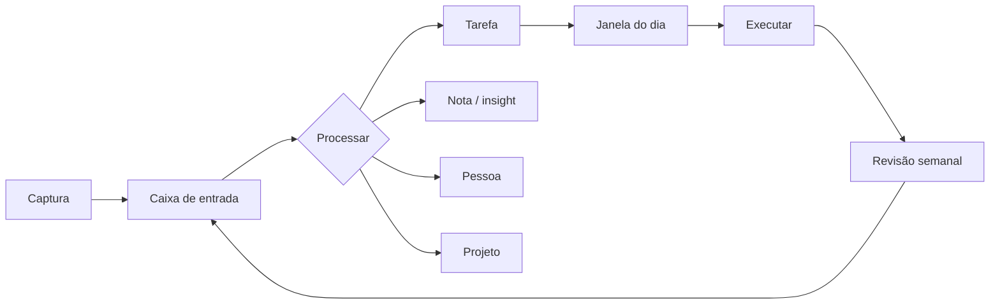

<div align="center">


# Zyra

**Sistema pessoal local-first para capturar tudo o que chega, dar destino e colocar em prática.**

Ideias, insights, pessoas, projetos, tarefas e informações — organizados no ritmo das janelas do dia.

> Primeiro você. Depois o que você serve.

<br />


</div>

---

## O que é

Zyra não é mais um lugar para guardar informação. É um sistema para **fechar o ciclo**:

```
capturar → processar → priorizar → agendar na janela → executar → revisar
```

A maioria dos apps de produtividade para na captura: você anota, arquiva e nunca mais olha. Aqui cada item que entra na caixa de entrada **precisa de um destino** — e cada destino tem um próximo passo.

- **Nada fica solto na cabeça.** Tudo entra na Caixa de entrada e é processado em tarefa, nota, pessoa ou projeto.
- **Pouca coisa importa por dia.** No máximo 3 prioridades, com uma estrela de foco.
- **O dia tem ritmo.** As 12 janelas do relógio dos órgãos viram faixas de 2h com uma intenção clara.
- **O ciclo fecha.** Uma revisão semanal mostra o que ficou para trás — sem culpa, com decisão.

### O fluxo, em um diagrama



---

## Funcionalidades

| Tela | O que faz |
|---|---|
| **Hoje** | Janela atual com intenção, tempo restante, as 3 prioridades, captura rápida e alertas do que pede atenção. |
| **Caixa de entrada** | Captura sem julgar. Cada item vira tarefa, nota, pessoa, projeto — ou é arquivado/excluído. |
| **Tarefas** | Lista única com filtros por área e projeto, grupos por atraso/hoje/semana, foco, conclusão e adiamento em 1 clique. |
| **Notas** | Insights, notas e referências com tags, área e vínculo com pessoas e projetos. |
| **Pessoas** | Rede com contexto, último contato, próximo passo e data — para não deixar relações esfriarem. |
| **Projetos** | Resultado esperado, status, próxima ação e progresso a partir das tarefas vinculadas. |
| **Janelas** | As 12 faixas do dia, o órgão e o modo de cada uma, com ritual diário marcável. |
| **Revisão** | Fechamento semanal: inbox, atrasadas, projetos parados, pessoas sem contato, rituais e registro da semana. |

Outros detalhes:

- **Dados locais** em um único arquivo SQLite (`data/zyra.db`), sem conta, sem nuvem, sem telemetria.
- **PWA instalável** no celular quando aberto pelo IP do Mac na mesma rede Wi-Fi.
- **Backup** em um comando (`npm run backup`).
- **Dados de exemplo** na primeira execução, removíveis em um botão na tela de Revisão.

---

## Stack (e por que ela)

| Camada | Escolha | Motivo |
|---|---|---|
| App | **Next.js 16** (App Router, React 19, Server Components + Server Actions) | Uma base só para tela e servidor, sem API separada. Rápido de evoluir. |
| Linguagem | **TypeScript** | Segurança para crescer sem quebrar o que já funciona. |
| Estilo | **Tailwind CSS 4** | Design consistente sem arquivos CSS espalhados. |
| Dados | **libSQL / SQLite** (`@libsql/client`) | Zero instalação e zero conta no dev (arquivo `data/zyra.db`); em produção, o mesmo SQL roda no **Turso** com link fixo. |
| Offline/local | **PWA** (manifest + ícone) | Dá para instalar na tela inicial do celular quando acessado pelo IP do Mac. |
| Futuro | Postgres/Supabase ou Turso/libSQL | Só quando existir necessidade real de sincronizar entre aparelhos. |

**Por que não começar com Supabase, Firebase ou um backend na nuvem?**
Porque o problema hoje é **organizar a própria vida**, não escalar para milhares de usuários. SQLite local é mais rápido, privado e barato. A migração para nuvem é possível depois, sem refazer a interface.

**Por que não React Native/Expo?**
O custo de manter dois apps (web + mobile) não se paga nesta fase. Como PWA, o mesmo app abre no celular. Se um dia o uso mobile passar de 80%, aí vale um app nativo — e a API já estará pronta.

**Por que não Notion/Obsidian?**
Eles guardam informação; este app foi desenhado para **fechar o ciclo**: captura → processa → escolhe a janela → executa → revisa. A estrutura força a decisão, não só o arquivamento.

---

## Como rodar

Requisitos: **Node.js 22+** (testado no 26).

```bash
npm install
npm run dev
```

Abra <http://localhost:3001>.

Build de produção:

```bash
npm run build
npm start
```

Verificação de tipos:

```bash
npm run typecheck
```

### Celular na mesma rede Wi-Fi

```bash
ipconfig getifaddr en0        # pega o IP do Mac
# abra http://SEU-IP:3001 no navegador do celular
# no Safari: compartilhar → Adicionar à Tela de Início
```

> Localmente o app **não tem login**. Em produção, ative a senha com `ZYRA_PASSWORD` e use HTTPS.

---

## Deploy em produção

Dois caminhos, ambos com **link fixo** e **banco persistente**:

| Caminho | Banco | Ideal para |
|---|---|---|
| **Vercel + Turso** | libSQL remoto | Grátis, link `*.vercel.app`, sem manutenção |
| **Docker + volume** | arquivo SQLite em `/data` | VPS, Railway, Render, Fly.io |

```bash
# Vercel + Turso
turso db create zyra --location iad     # banco zerado
vercel env add ZYRA_DB_URL production   # libsql://...
vercel env add ZYRA_DB_AUTH_TOKEN production
vercel env add ZYRA_PASSWORD production
vercel --prod
```

```bash
# Docker com volume persistente (banco em arquivo)
docker compose up -d --build
```

Principais variáveis:

| Variável | Padrão | Para que serve |
|---|---|---|
| `ZYRA_DB_URL` | — | URL do banco remoto (Turso). Sem ela, usa arquivo local. |
| `ZYRA_DB_AUTH_TOKEN` | — | Token do Turso. |
| `ZYRA_DATA_DIR` | `./data` | Pasta do SQLite local. Em Docker: `/data`. |
| `ZYRA_SEED` | `0` em produção | `0` = **banco zerado**; `1` = dados de exemplo. |
| `ZYRA_PASSWORD` | vazio | Ativa HTTP Basic Auth. **Defina em produção.** |
| `ZYRA_USER` | `zyra` | Usuário do Basic Auth. |
| `PORT` | `3001` | Porta do servidor. |

O guia completo (Turso, Vercel, Railway, Render, Fly.io, VPS, backup e checklist de segurança) está em **[DEPLOY.md](DEPLOY.md)**.

Healthcheck: `GET /api/health` → `{ "ok": true, "banco": "remoto (libSQL)", "tarefas": 0 }`.

> Sem `ZYRA_PASSWORD`, o app fica aberto para quem tiver o link. Com ela, o navegador pede usuário e senha antes de qualquer página.

---

## As janelas do dia

O app completa as 12 faixas do relógio dos órgãos (a lista original ia até 19h; 19–21 entrou como **Pericárdio** e 21–23 como **Triplo Aquecedor**).

| Janela | Órgão | Modo |
|---|---|---|
| 23–01 | Vesícula Biliar | Fechar o dia |
| 01–03 | Fígado | Soltar |
| 03–05 | Pulmão | Inspirar |
| 05–07 | Intestino Grosso | Eliminar |
| 07–09 | Estômago | Nutrir |
| 09–11 | Baço/Pâncreas | Focar |
| 11–13 | Coração | Conectar |
| 13–15 | Intestino Delgado | Discernir |
| 15–17 | Bexiga | Liberar |
| 17–19 | Rins | Gratidão |
| 19–21 | Pericárdio | Proteger |
| 21–23 | Triplo Aquecedor | Recolher |

É um **ritmo simbólico**, não diagnóstico médico. O app trata as janelas como convite à pausa e ao foco — seu corpo tem a última palavra.

---

## Estrutura do projeto

```
app/
  page.tsx          # Hoje: janela atual, 3 prioridades, captura, alertas
  inbox/            # captura e processamento
  tarefas/          # lista única com filtros e grupos
  notas/            # insights, notas e referências
  pessoas/          # rede com contexto e próximo passo
  projetos/         # resultado + próxima ação + progresso
  janelas/          # as 12 janelas e rituais do dia
  revisao/          # fechamento semanal
  api/health/       # healthcheck do deploy
  actions.ts        # todas as mutações (server actions)
  layout.tsx        # navegação, metadados e PWA
  globals.css       # tema (papel, tinta e ouro)
lib/
  db.ts             # schema, seed e cliente libSQL (arquivo local ou Turso)
  queries.ts        # leituras
  janelas.ts        # dados do relógio dos órgãos
  format.ts         # datas em pt-BR
  config.ts         # seu nome
  types.ts          # tipos compartilhados
components/         # UI, navegação, captura, processamento
public/             # ícone e manifest da PWA
proxy.ts            # HTTP Basic Auth opcional (produção)
Dockerfile          # imagem de produção (Node + standalone)
docker-compose.yml  # app + volume persistente
DEPLOY.md           # guia de deploy
data/zyra.db        # seu banco (ignorado pelo git)
```

Para trocar o nome exibido, edite `lib/config.ts`.

---

## Dados, privacidade e backup

- No dev, o banco fica em `data/zyra.db` e **não é versionado** (`.gitignore`).
- Em produção, o banco fica no Turso (libSQL remoto) — mesmas tabelas, mesmo SQL.
- Não há rastreamento nem chamada para serviços externos além do próprio banco.
- Em produção, ative a senha com `ZYRA_PASSWORD` — o `proxy.ts` protege todas as páginas com HTTP Basic Auth.
- Para trocar o diretório dos dados, defina `ZYRA_DATA_DIR`.

O banco é um arquivo só. Com o app parado, copie `data/` inteiro. Ou use:

```bash
npm run backup
```

Os backups ficam em `backups/` (também ignorado pelo git).

---

## Roadmap (em ordem de valor)

1. **Usar por 7 dias** e anotar onde travou. O melhor roadmap vem do uso real.
2. Editar tarefas/notas e busca global (hoje só cria, conclui e exclui).
3. PWA offline de verdade (service worker) e atalho de captura.
4. Processamento assistido por IA: transformar um despejo de ideias em sugestões de tarefas/notas — sempre com revisão humana.
5. Login multiusuário (hoje há uma senha única) e sincronização entre aparelhos — já garantida pelo Turso.
6. Exportar tudo em Markdown para nunca ficar preso ao app.

---

## Estado atual

- [x] Captura → processamento → tarefa/nota/pessoa/projeto
- [x] Janelas do dia com ritual e tarefas por faixa
- [x] 3 prioridades, foco e conclusão
- [x] Pessoas com próximo passo e registro de contato
- [x] Projetos com próxima ação e progresso
- [x] Revisão semanal
- [x] Backup local
- [x] PWA instalável
- [x] Deploy online com banco persistente (Vercel + Turso) e senha

---

<div align="center">
  <sub>Projeto pessoal, feito para uso próprio — e para lembrar que a vida acontece fora da tela.</sub>
</div>
